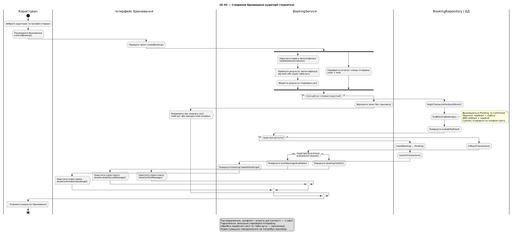

# Завдання 4 — Процес / поведінка

**Студент:** Чакун Олександр  
**Група:** ІМ-о51

## Опис

Робота продовжує систему бронювання навчальних аудиторій. Для UC-02 «Створити бронювання» використано одну нотацію — Activity Diagram (PlantUML). Діаграма показує процес від вибору аудиторії та часу до отримання результату користувачем.

## Діаграма

[Вихідний код PlantUML](model/activity.puml) · [PNG](renders/activity.png)

У процесі показано паралельну перевірку сесії та часового інтервалу, об'єднання гілок, повторну перевірку доступності в транзакції та створення Booking зі статусом Pending або відмову. Запит validateSession(session) надсилається зовнішньому сервісу автентифікації; передбачено відповідь або локальний тайм-аут. Повідомлення користувачу не потребує відповіді.

## Зв'язок із попередніми роботами

| Сценарій | Результат процесу |
|---|---|
| SC-02 | Створення бронювання за наявності вільної аудиторії |
| SC-03 | Відмова через конфлікт часових інтервалів |
| SC-07 | Повідомлення про втрату доступності після пошуку |
| SC-08 | Створення бронювання для суміжних інтервалів |

- [Lab1 — модель даних](../lab1/)
- [Lab2 — Gherkin-сценарії](../lab2/gherkin.md)
- [Lab3 — Sequence Diagram](../lab3/model/)

## Документи

- [spec.md](spec.md) — опис процесу та технічних рішень.
- [AUDIT.md](AUDIT.md) — розбіжності та виправлення.
- [DEFENSE.md](DEFENSE.md) — матеріал для захисту.
- [ai/prompts.md](ai/prompts.md) — документація використання AI.

Паралельна перевірка, обробка тайм-ауту та searchContext є запропонованими уточненнями Lab4. Конкретна тривалість тайм-ауту та спосіб збереження контексту пошуку не визначені.
